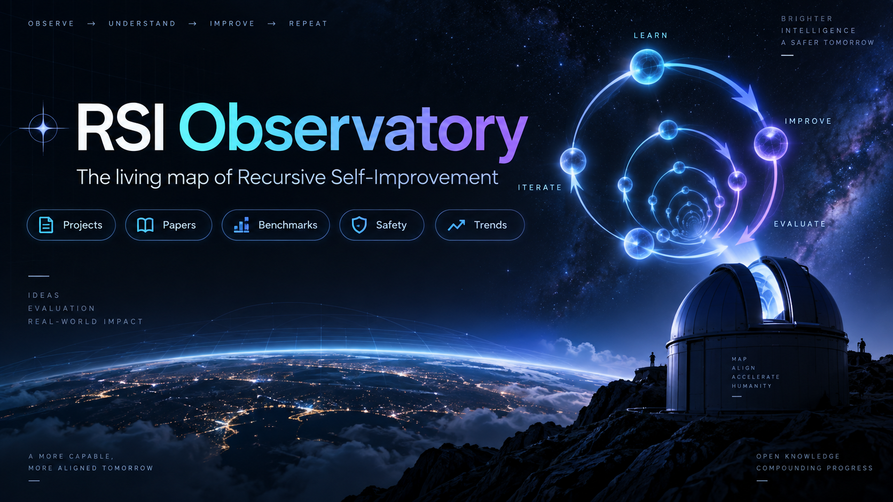
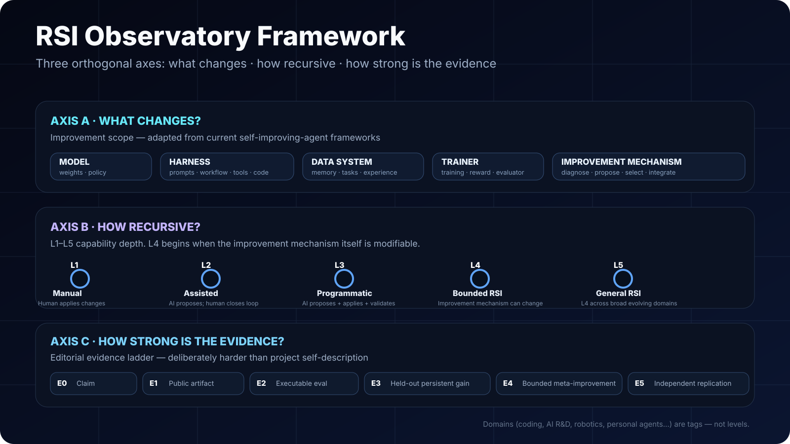
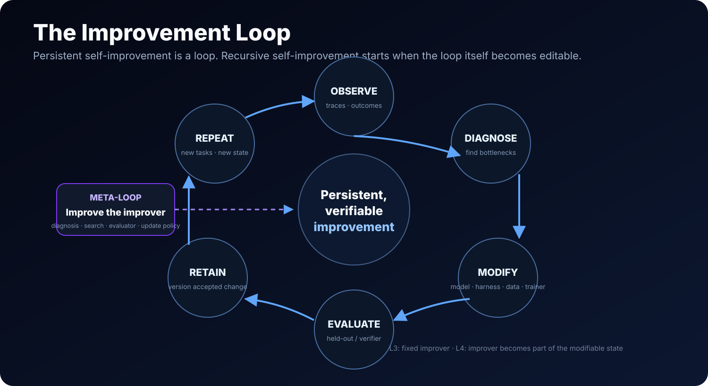

  

  
  
  
  

<strong>Projects · Research · Benchmarks · Evidence · Safety · Labs · Timeline · Trends</strong>

> **RSI Observatory is an opinionated, evidence-driven living map of Recursive Self-Improvement.** It is built to answer three questions: **what is changing, how recursive is it, and how strong is the public evidence?**

**RSI = Recursive Self-Improvement**, not the trading Relative Strength Index.

**[Open the live website →](https://fucheng1245.github.io/RSI-Observatory/)**

**New here? [Take the five-minute tour →](START_HERE.md)**

---

## Why this exists

The field is growing fast, but the vocabulary is messy. “Self-refine”, “self-evolve”, “self-improving agent”, “AI researcher” and “RSI” are often used for systems with very different capabilities.

The Observatory does **not** solve that by making a bigger link dump. It adds an evidence layer:

<table>
<tr><td width="33%" valign="top"><h3>🗺️ Map</h3>
Organize work by <b>what changes</b>: model, harness, data, trainer, improvement mechanism.

<a href="LANDSCAPE.md"><b>Explore the landscape →</b></a>
</td>
<td width="33%" valign="top"><h3>🧬 Judge</h3>
Separate L3 persistent self-improvement from L4 bounded RSI instead of trusting project names.

<a href="SCORECARD.md"><b>Open the scorecard →</b></a>
</td>
<td width="33%" valign="top"><h3>🔥 Track</h3>
Watch projects, fresh papers, benchmarks and weekly movement instead of freezing the field in time.

<a href="radar/LATEST.md"><b>Read the Radar →</b></a>
</td></tr>
</table>

---

## The method in one screen

**Axis A — what changes?** `Model · Harness · Data · Trainer · Improvement Mechanism`

**Axis B — how recursive?** `L1 Manual → L2 Assisted → L3 Programmatic Self-Improvement → L4 Bounded RSI → L5 General RSI`

**Axis C — how strong is the evidence?** `E0 Claim → E1 Artifact → E2 Executable Eval → E3 Persistent Held-out Gain → E4 Meta-Improvement → E5 Independent Replication`

> **Key boundary:** L4 begins when the **improvement mechanism itself** becomes modifiable. Automated research, persistent memory, or a closed loop can all be important without crossing that boundary.

[Read the full methodology →](METHODOLOGY.md)

---

## Scorecard snapshot

| System | Role | Scope | Depth | Improver mutable? | Evidence |
|---|---|---|---|---|---|
| [Darwin Gödel Machine](https://github.com/jennyzzt/dgm) | Direct RSI | Harness / agent source code | L4 | yes | E4 |
| [Gödel Agent](https://github.com/Arvid-pku/Godel_Agent) | Direct RSI | Harness / agent code | L4 | yes | E4 |
| [OpenRSI / OpenMLE](https://github.com/FrontisAI/OpenRSI) | RSI-directed meta-evolution | Model + harness + trainer | L4-like framing; recursion unverified | trained improver; autonomous meta-loop unverified | E3 |
| [Recuris](https://github.com/Gen-Verse/Recuris) | Self-improving system | Data system / memory + harness | L3 | not demonstrated | E3 |
| [Prime Agent](https://github.com/PrimeIntellect-ai/prime-agent) | Self-improving system | Harness / skills / coding workflow | L3-like | not demonstrated | E1 |
| [KnowAct](https://github.com/HITsz-TMG/KnowAct) | Self-improving system | Data system + harness | L3-like | not demonstrated | E2 |
| [Reflexion](https://arxiv.org/abs/2303.11366) | Enabling / self-improving memory | Data system / memory | L3 | no | E2 |
| [The AI Scientist](https://github.com/SakanaAI/AI-Scientist) | Adjacent AI R&D | Research process | Not RSI-scored | no | E2 |
| [LightRSI](https://github.com/zjunlp/LightRSI) | RSI substrate | Harness / runtime | N/A (substrate) | score instantiated loop | E1 |

**Why this is conservative:** the 2026 *Path to Recursive Self-Improving Agents* survey grades **Gödel Agent** and **Darwin Gödel Machine** L4. OpenRSI describes its current starting point as bounded **Meta-Evolution — training the improver itself — while explicitly not claiming general RSI is solved**. Other self-improving systems stay L3/L3-like here until comparable public evidence appears.

Author-reported evidence; no independent reproduction by this Observatory. [Review scope and corrections](SOURCE_REVIEW.md).

[Full scorecard + rationale →](SCORECARD.md)

---

## The improvement loop

A useful mental model is:

`Observe → Diagnose → Modify → Evaluate → Retain → Repeat`

At L3, that loop can improve persistent system components. At L4, the **meta-loop** can also change how diagnosis, proposal, evaluation or integration will work in future rounds.

---

## Research Library

The curated library contains **213 works** with separate relevance labels:

- **Core** — persistent self-improvement, self-modification, or recursive/meta-improvement is central. **Core does not automatically mean L4 RSI.**
- **Enabling** — memory, verification, tooling, optimization and other mechanisms useful to self-improvement.
- **Adjacent** — automated AI R&D, evaluation, open-ended search and safety work that materially informs RSI.
- **Foundational** — theory, surveys and historical work.

The website exposes the index as a searchable library; [`data/paper-index.json`](data/paper-index.json) is machine-readable.

[Browse the 213-work Research Library →](PAPERS.md)

---

## Featured systems by role

<table>
<tr><td width="50%" valign="top"><h3>🧬 Direct RSI</h3>
<b><a href="https://github.com/jennyzzt/dgm">Darwin Gödel Machine</a></b> — L4 in the 2026 survey; evolves agent code and retains validated variants.

<b><a href="https://github.com/Arvid-pku/Godel_Agent">Gödel Agent</a></b> — L4 in the same survey; self-referential agent logic.
</td>
<td width="50%" valign="top"><h3>🧪 RSI-directed</h3>
<b><a href="https://github.com/FrontisAI/OpenRSI">OpenRSI / OpenMLE</a></b> — executable AI4AI and bounded meta-evolution; explicitly framed as progress toward RSI rather than a claim that general RSI is solved.
</td></tr>
<tr><td width="50%" valign="top"><h3>🧠 Self-improving systems</h3>
<b><a href="https://github.com/Gen-Verse/Recuris">Recuris</a></b> — persistent experiential/working-memory evolution.

<b><a href="https://github.com/PrimeIntellect-ai/prime-agent">Prime Agent</a></b> — long-running self-improving coding agent.

<b><a href="https://github.com/HITsz-TMG/KnowAct">KnowAct</a></b> — persistent personal-agent improvement.
</td>
<td width="50%" valign="top"><h3>🔭 Substrates & adjacent systems</h3>
<b><a href="https://github.com/zjunlp/LightRSI">LightRSI</a></b> — runtime/substrate; score the instantiated loop, not the runtime.

<b><a href="https://github.com/SakanaAI/AI-Scientist">AI Scientist</a></b> — important automated AI R&D, but not automatically RSI.
</td></tr>
</table>

[Browse projects & systems →](PROJECTS.md)

---

## Benchmarks: different questions, not one leaderboard

| Benchmark | Main question |
|---|---|
| [PAST-Bench](https://arxiv.org/abs/2608.04003) | Does retained experience make later behavior measurably better? |
| [RSI-Exam](https://github.com/aiming-lab/RSI-Exam) | Can agents improve executable research methods over long horizons? |
| [AI4AI-Bench](https://arxiv.org/abs/2608.20318) | Can agents improve training algorithms under executable evaluation? |
| [PostTrainBench](https://arxiv.org/abs/2603.08640) | Can agents autonomously choose and execute post-training strategies under real budgets? |
| [RE-Bench](https://github.com/METR/RE-Bench) | How capable are agents at open-ended ML research engineering? |

[Understand what each benchmark really measures →](BENCHMARKS.md)

---

## Live Observatory

### Repository momentum

Seven-day changes require a snapshot from exactly seven days earlier. A dash means that baseline is not available.

<!-- TRENDING_START -->
| Repository | Category | Stars | 7d Δ | Forks | Last push |
|---|---|---:|---:|---:|---|
| [PrimeIntellect-ai/prime-agent](https://github.com/PrimeIntellect-ai/prime-agent) | Self-improving agent | 22698 | +85 | 2516 | 2026-11-14 |
| [lobehub/awesome-rsi](https://github.com/lobehub/awesome-rsi) | Research map | 1015 | +51 | 88 | 2026-10-15 |
| [SakanaAI/AI-Scientist](https://github.com/SakanaAI/AI-Scientist) | Automated AI R&D | 14992 | +37 | 2089 | 2025-12-19 |
| [FrontisAI/OpenRSI](https://github.com/FrontisAI/OpenRSI) | Core / AI4AI | 901 | +29 | 85 | 2026-09-17 |
| [jennyzzt/dgm](https://github.com/jennyzzt/dgm) | Open-ended agent evolution | 2507 | +20 | 465 | 2025-08-13 |
| [selfimproving-agent/Awesome-Self-Improving-Agents](https://github.com/selfimproving-agent/Awesome-Self-Improving-Agents) | Research map | 629 | +14 | 74 | 2026-11-13 |
| [Gen-Verse/Recuris](https://github.com/Gen-Verse/Recuris) | Memory evolution | 273 | +6 | 34 | 2026-08-30 |
| [aiming-lab/RSI-Exam](https://github.com/aiming-lab/RSI-Exam) | Benchmark | 198 | +6 | 9 | 2026-11-06 |
| [scaleapi/rsi-benchmark](https://github.com/scaleapi/rsi-benchmark) | Benchmark | 121 | +6 | 62 | 2026-11-13 |
| [CosmosMind-ai/RSI-Harness](https://github.com/CosmosMind-ai/RSI-Harness) | Harness evolution | 281 | +4 | 29 | 2026-10-10 |
| [Arvid-pku/Godel_Agent](https://github.com/Arvid-pku/Godel_Agent) | Self-modifying agent | 243 | +4 | 54 | 2025-09-17 |
| [zjunlp/LightRSI](https://github.com/zjunlp/LightRSI) | Runtime | 86 | +4 | 16 | 2026-10-03 |
| [D2I-ai/awesome-recursive-self-improving-agents](https://github.com/D2I-ai/awesome-recursive-self-improving-agents) | Research map | 64 | +1 | 6 | 2026-10-22 |
| [Gen-Verse/PAST-Bench](https://github.com/Gen-Verse/PAST-Bench) | Benchmark | 36 | +1 | 9 | 2026-08-05 |
| [Tencent/VideoHarness-RSI](https://github.com/Tencent/VideoHarness-RSI) | Harness evolution | 13 | +1 | 0 | 2026-10-28 |
<!-- TRENDING_END -->

### Recent paper feed

Automatically discovered papers are candidates for review, not curated endorsements.

<!-- PAPERS_START -->
- **[PhysLoop: Harnessing LLMs' Physics Awareness for Self-Improving Video Generation Models](http://arxiv.org/abs/2611.16748v1)** — Yuxuan Chen, Xiaojie Li, Hao Chen et al. (2026-11-12)
- **[Experience-Handoff Reinforcement Learning for Recursive Self-Improvement](http://arxiv.org/abs/2611.16409v1)** — Doyoung Kim, Byeongguk Jeon, Kailin Zhang et al. (2026-11-12)
- **[Reward-Driven Collider Physics Challenges for Self-Improving Agentic AI via Reinforcement Learning](http://arxiv.org/abs/2611.15885v1)** — Alexander Yue, Qibin Liu, Julia Gonski (2026-11-11)
- **[AskALCF: A Self-Improving Agentic System for Intelligent HPC User Support](http://arxiv.org/abs/2611.15700v1)** — Jingyan Jiang, Akhilesh Bondapalli, Krishna Rauniyar et al. (2026-11-11)
- **[RSI-PDEbench: A Benchmark for Self-Improving Agents in PDE Solving](http://arxiv.org/abs/2611.14949v1)** — Binghang Lu, Lang Cao, Changhong Mou et al. (2026-11-11)
- **[WAM is capable in BEHAVIOR-1K: the 2nd-place solution to the 2026 BEHAVIOR Challenge](http://arxiv.org/abs/2611.13818v1)** — Yelin He, Jiaquan Ye, Xinming Wei et al. (2026-11-10)
- **[Toward Autonomous RTL and Synthesis Optimization: Benchmarking and Self-Improving Agents](http://arxiv.org/abs/2611.13713v1)** — Wenji Fang, Yao Lu, Jinghua Wang et al. (2026-11-10)
- **[The RSI Tax: When Recursive Self-Improvement Is Not Worth the Cost](http://arxiv.org/abs/2611.13524v1)** — Yitong Zhang, Ang Li, Yisen Wang (2026-11-10)
- **[NCP: Verifier-Guided Optimization of Weight-Space Control Policies](http://arxiv.org/abs/2611.13236v1)** — Ekrem Aksoy (2026-11-09)
- **[SciMARS: Multi-Agent Recursive Self-Improvement for Closed-Loop Scientific Discovery](http://arxiv.org/abs/2611.12552v1)** — Weimin Wu, Han Liu (2026-11-09)
- **[ForgeSystem: An Architecture for Demand-Specific Artefact Production with AI Agents](http://arxiv.org/abs/2611.12288v1)** — Qingfeng He, Zhui Zhu, Yaojian Chen et al. (2026-11-09)
- **[SkillDuet: Co-Evolving Models and Skills through Response Feedback](http://arxiv.org/abs/2611.12109v2)** — Xingguang Ji, Ziqiang Dong, Yubo Zhang et al. (2026-11-09)
<!-- PAPERS_END -->

The automated layer tracks GitHub metadata, daily snapshots and a fresh paper feed. Human curation stays separate from automation.

- **Daily:** repository stars, forks, push time and historical snapshots.
- **Weekly:** a Radar digest for high-signal changes.
- **Curated:** project roles, L-depth, E-evidence, featured papers and benchmark interpretation.

> Machines maintain **breadth and freshness**. Humans maintain **importance and judgment**.

[Project trends →](TRENDS.md) · [Latest weekly Radar →](radar/LATEST.md) · [Labs & teams →](LABS.md) · [Safety →](SAFETY.md) · [Timeline →](TIMELINE.md)

---

## Disagree with a classification?

Good. The scorecard should be challengeable.

Open a **classification correction** Issue with the exact field, proposed replacement and supporting public evidence. The default policy is to **under-claim rather than inflate**.

[Contributing guide →](CONTRIBUTING.md) · [Methodology →](METHODOLOGY.md)

---

<strong>RSI Observatory</strong> Map what matters. Track what moves. Keep the labels meaningful.

